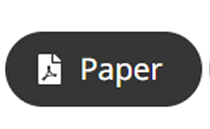
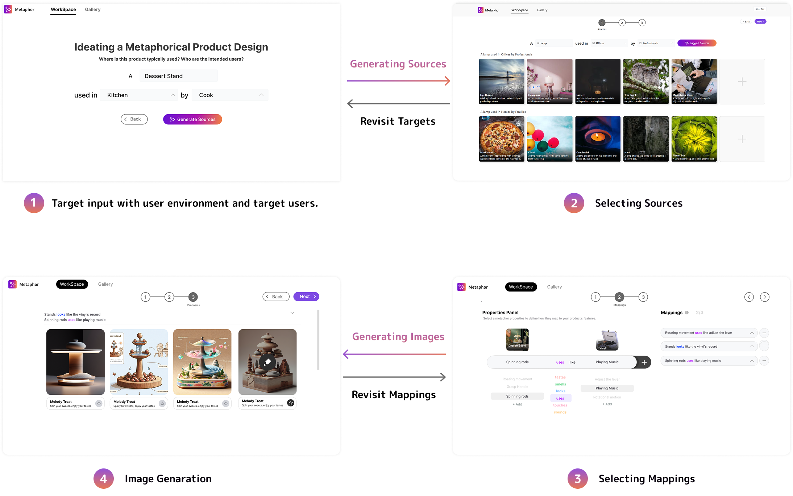
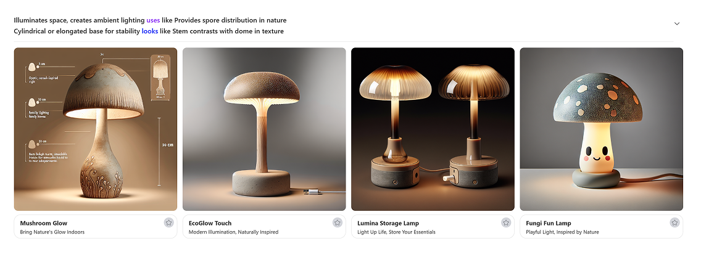

<h1 align="center">
DICE (Directions In Creative Entanglement）</h1>

<h4 align="center">
	<a href="https://microsoft.github.io/DICE/metaphor" target=""> </a> 
	<span>&nbsp;</span>
	<a href="https://doi.org/10.1145/3706598.3713935" target="_blank">  </a> 
</h4>


## 🌟 Introduction
Project DICE is an AI-driven creative tool designed to help designers create every day, everywhere. This project integrates core concepts of design, inspiration, and creation, providing an efficient and innovative platform for designers to explore new creative realms and enhance design quality and efficiency. Utilizing multimodal large language models, DICE generates diverse and contextually relevant design inspirations, supporting structured creative exploration. One of our key exploration paths is the use of metaphors, a widely used method in design thinking.  

We introduce Metaphor, a creativity support tool that connects targets (the products being designed) with sources (inspirational concepts), combining these two components to spark new design ideas. This tool is designed to help novice designers explore and develop metaphorical product concepts, offering richer inspiration and support throughout the creative process.
<br/>

<h3 align="center">Metaphor: A creative thinking tool in the DICE system</h3>
<br/>
<div align="center">

</div>
<br/><br/>

## 🚀 Quick start

### 🛠️ setup Backend Service
```
In backend folder:

gunicorn productmeta_backend.asgi:application -k uvicorn.workers.UvicornWorker --workers 2 --bind 0.0.0.0:8000
```
<br/>

### 🌐 Setup Frontend Service
```
In frontend folder:
1. Install dependencies using npm
npm install

2. Start the development server
npm run dev
```
<br/>


## 👀 Metaphor Demo Presentation

<div align="center">

</div>
<br/>


## 📃 Paper
```
@unpublished{zhou2024Metaphor,  
	title = {Metaphor: Supporting Ideation in Metaphorical Product Design through Multimodal Large Models},  
	author = {Zhou, Qinyi and Deng, Jie and Liu, Yu and Wang, Yun and Xia, Yan and Ou, Yang and Lu, Zhicong and Li, Scarlett and Xu, Yingqing},  
	year = {2025},  
	note = {Conditionally accepted to CHI 2025},  
	selected = {true},  
	preview = {Metaphor.png},  
	pdf = {Metaphor_1210clear.pdf},  
	html = {/papers/paper1/}  
}
```
<br/>


## 🤝 Contributing
Yu Liu, Yun Wang, Yan Xia, Yang Ou, Scarlett Li
Collaborated with Tsinghua Future Lab and Hongkong City University

<br/>
<br/>

## ⚖️ Disclaimer
Due to the inherent limitations of large language models, issues such as hallucinations may occur.
